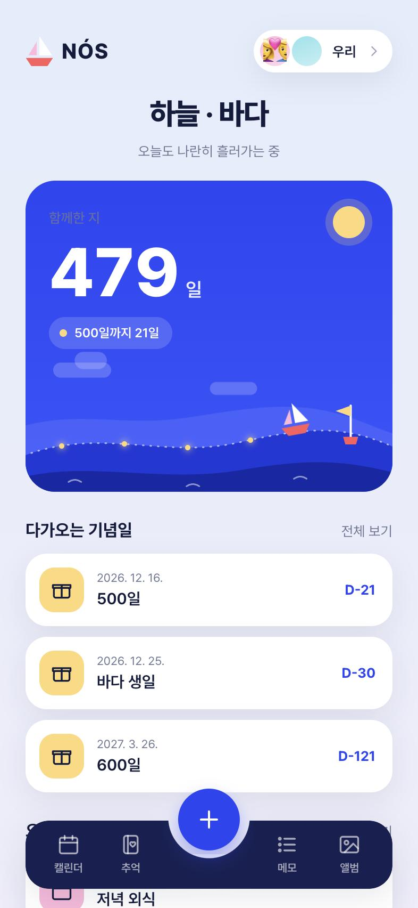
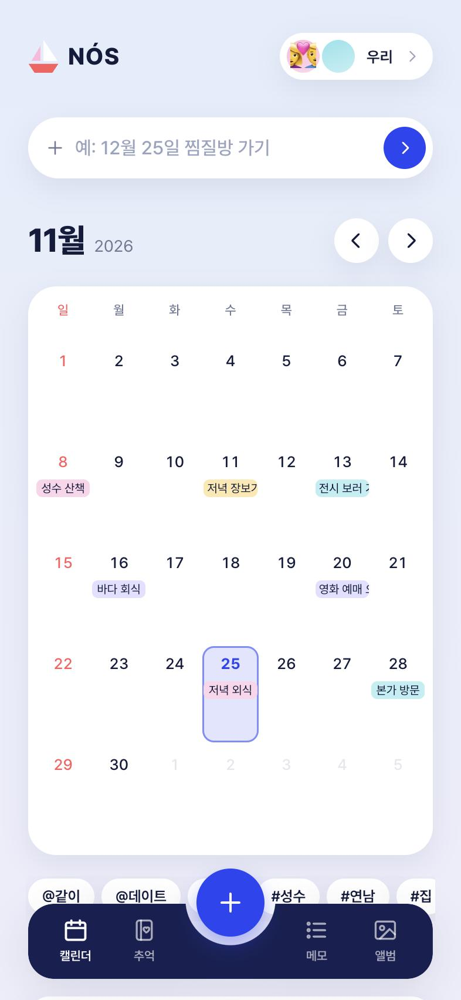
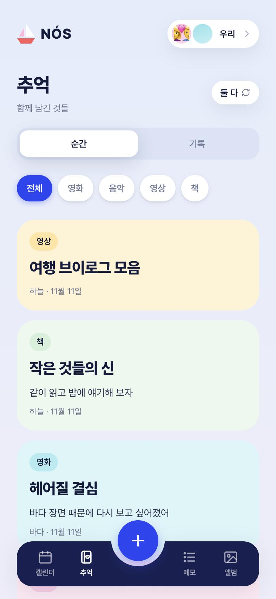
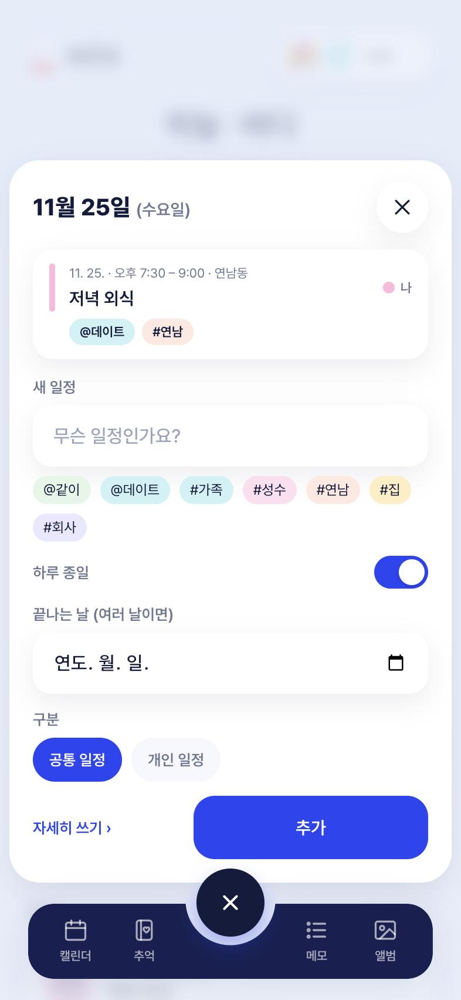
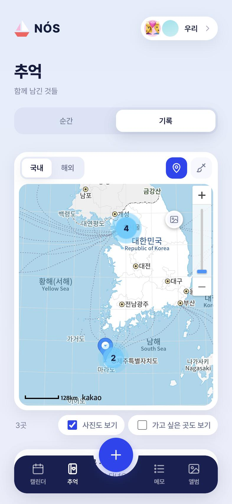
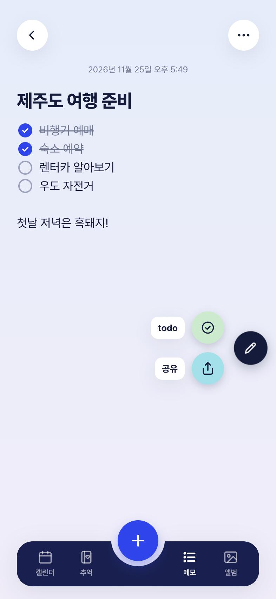
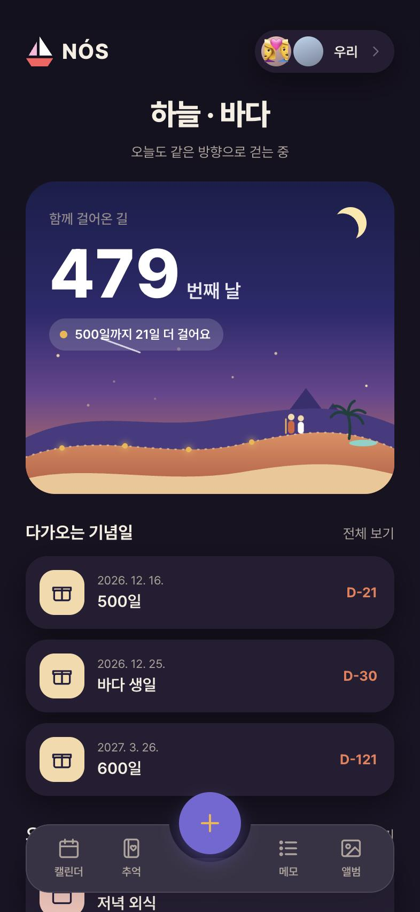

# NÓS (노스)

**둘이 함께 쓰는 우리만의 공간.** 일정, 함께 본 영화와 음악, 다녀온 곳, 사진, 버킷리스트, 기념일을 한곳에 모아요.

**NÓS**는 포르투갈어로 **우리**, 그리고 **매듭**이라는 뜻이에요. 두 사람을 하나로 묶어 두는 작은 매듭 같은 앱을 만들고 싶었어요.

  
  
  

## 앱처럼 쓰기 — 홈 화면에 추가

NÓS는 앱스토어에 올린 앱이 아니에요. **휴대폰 브라우저에서 '홈 화면에 추가'를 한 번 하면, 그다음부터는 앱처럼 써요.** 저도, 여자친구도 이렇게 쓰고 있어요.

**아이폰 (크롬)**
1. 크롬으로 NÓS 주소를 열고 로그인해요.
2. 주소창 오른쪽의 **공유 버튼**(네모에 위쪽 화살표)을 눌러요.
3. **'홈 화면에 추가'** → **'추가'**를 눌러요.

> 사파리에서도 똑같이 아래쪽 공유 버튼 → '홈 화면에 추가'로 할 수 있어요.

**안드로이드 (크롬)**
1. 크롬으로 NÓS 주소를 열고 로그인해요.
2. 오른쪽 위 **⋮** 메뉴 → **'홈 화면에 추가'**(또는 **'앱 설치'**)를 눌러요.

이렇게 추가하면

- 홈 화면에 **NÓS 아이콘**이 생기고, 누르면 바로 열려요.
- 주소창 없이 **화면 전체**를 쓰고, 열 때 작은 시작 화면이 나와요. 진짜 앱과 거의 구별이 안 돼요.
- 로그인은 한 번만 하면 그대로 유지돼요.
- **기념일·메모 알림**도 받을 수 있어요. (아이폰은 홈 화면에 추가한 NÓS에서만 알림이 와요.)
- 새 기능을 올리면 따로 업데이트할 필요 없이 다음에 열 때 바로 바뀌어요.

## 시작하기

1. **카카오** 또는 **Google**로 시작해요. 따로 회원가입은 없어요.
2. 한 사람이 **우리 공간**을 만들고, 화면에 나온 **초대 코드**를 상대에게 보내요.
3. 상대가 초대 코드를 넣으면 두 사람이 연결돼요. 이제부터 모든 것을 둘이 함께 보고 함께 고쳐요.

## 무엇을 할 수 있나요

### 홈 — 오늘 우리
함께한 날을 세어 주고(D+일), 다가오는 기념일과 **오늘·내일 일정**, 두 사람이 **최근에 남긴 것**을 한눈에 보여 줘요. 100일·주년 같은 기념일은 사귀기 시작한 날로 저절로 계산해요.

### 캘린더 — 둘의 일정을 한 달력에
- **공통 일정**(함께 하는 일)과 **개인 일정**(한 사람의 일)을 한 달력에서 함께 봐요. 개인 일정에는 누구 일정인지 이름이 붙어요.
- 날짜를 누르면 그날 일정과 **빠른 추가** 창이 떠요.
- 맨 위 칸에 **"12월 25일 저녁 7시 찜질방"**처럼 그냥 쓰면, 날짜와 시간을 알아듣고 채워 줘요.
- `@데이트` `#성수`처럼 이름표를 붙여 모아 볼 수 있어요.
- 아이폰·구글 캘린더 앱에서 **구독**해서 볼 수도 있어요.

  

### 추억 — 순간과 기록
- **순간**: 함께 본 영화, 듣는 음악, 영상, 책을 남겨요. 유튜브·스포티파이 링크를 붙이면 제목과 썸네일을 알아서 가져오고 그 자리에서 바로 재생돼요. 서로 좋아요와 댓글도 달 수 있어요.
- **기록**: 함께 간 곳을 지도에 핀으로 남기고, 그곳에서 찍은 사진을 모아 봐요. 다녀온 지역을 **색칠 지도**로 채워 가는 재미도 있어요.
- **가고 싶은 곳**을 목록별로 모아 두고, 다녀오면 기록으로 옮겨요.

  

### 메모 — 버킷리스트와 여행 계획
- 아이폰 메모장처럼 쓰는 **함께 쓰는 메모장**이에요. 폴더(처음엔 '버킷리스트'·'여행계획')로 나눠요.
- 줄 맨 앞에 `- `를 치거나 화면 옆 **펜 버튼 → todo**를 누르면 체크 항목이 돼요.
- 쓰는 대로 **저절로 저장**되고, 상대가 메모를 고치면 **알림**이 와요.
- 펜 버튼의 **공유**로 아이폰 메모 앱이나 카톡에 그대로 보낼 수 있어요.

  

### 앨범 — 지나온 장면들
데이트 사진을 한 번에 여러 장 올리고 앨범으로 묶어요. 아이폰 사진(HEIC)도 그대로 올라가고, 구글 드라이브에서 골라 가져올 수도 있어요. **1년 전 오늘** 사진을 꺼내 보여 주기도 해요.

### 그리고
- 화면 아래 가운데 **+** 버튼은 지금 보고 있는 화면에 맞는 '추가'예요. (캘린더면 일정, 추억이면 순간·기록, 앨범이면 사진, 메모면 새 메모)
- 테마 두 가지 — 바다를 항해하는 **배**, 사막을 함께 걷는 **여정**(『연금술사』에서 따왔어요) — 와 라이트·다크 모드를 골라요.

  

## 둘만의 공간

- 우리 공간의 일정·사진·메모는 **연결된 두 사람만** 볼 수 있어요.
- 사진은 비공개 저장소에 두고, 잠깐 쓰는 서명 주소로만 보여 줘요.
- 프로필 사진은 촬영 위치 같은 정보를 지우고 작게 다시 만들어 저장해요.

## 만든 방법

Django 5.2(서버에서 화면을 그리는 방식) + 바닐라 JavaScript/CSS, 빌드 도구 없이 만들었어요. 홈 화면에 추가해 쓰는 웹 앱(PWA)이에요.
배포는 Vercel, 데이터베이스는 Neon(Postgres), 사진은 Cloudflare R2에 두고, 모두 무료 한도 안에서 돌아가요.

개발 환경, 배포, 로그인 키 발급 같은 만드는 사람을 위한 안내는 [docs/SETUP.md](docs/SETUP.md)에 있어요.

### 데이터 출처

지도 경계 — 통계청(KOSTAT) 행정구역 경계([southkorea-maps](https://github.com/southkorea/southkorea-maps), [seoul-maps](https://github.com/southkorea/seoul-maps)), 세계 지도 — [world-atlas](https://github.com/topojson/world-atlas)(Natural Earth), 지도 타일 — © OpenStreetMap 기여자.
